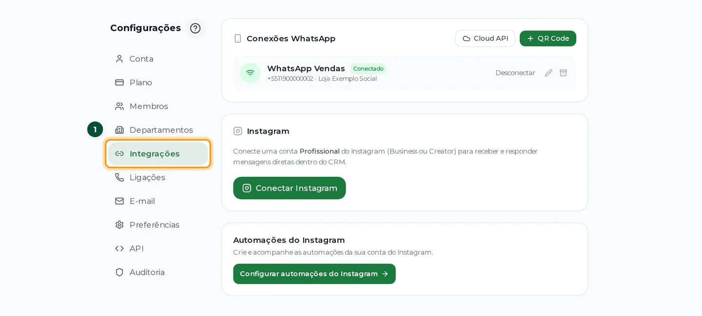
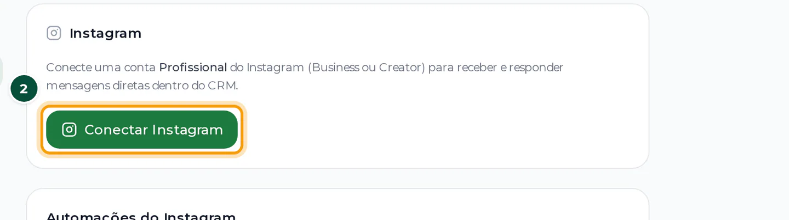
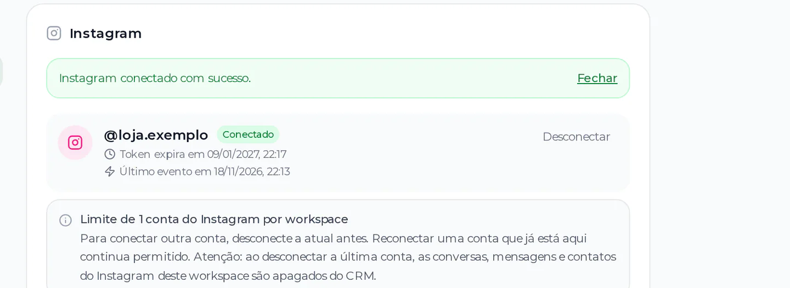

## O que é

O Vistum conecta a conta **profissional** do Instagram (Business ou Creator) da sua empresa e traz as mensagens do **Direct** para o mesmo inbox onde já está o WhatsApp. A equipe responde pelo CRM, sem trocar de tela.

<Note>
  Só **owner** ou **admin** do workspace podem conectar ou reconectar o Instagram.
</Note>

## Como conectar

<Steps>
  <Step title="Acesse Configurações > Integrações">
    No CRM, vá em **Configurações → Integrações**. A seção Instagram fica logo abaixo da seção WhatsApp.

    <Frame>
      
    </Frame>
  </Step>
  <Step title="Clique em Conectar Instagram">
    Você será redirecionado para o login da Meta.

    <Frame>
      
    </Frame>
  </Step>
  <Step title="Autorize pelo Instagram">
    Faça login com a conta do Instagram da empresa e autorize o Vistum a ler e enviar mensagens do Direct.
  </Step>
  <Step title="Aguarde a confirmação">
    Você volta para o CRM com a conta listada como **Conectado**. As próximas DMs recebidas já aparecem no inbox.

    <Frame>
      
    </Frame>
  </Step>
</Steps>

<Warning>
  A conta do Instagram precisa ser **Profissional** (Business ou Creator). Contas pessoais não completam a autorização.
</Warning>

## O que funciona

- **Inbox compartilhado** — as conversas de Instagram aparecem na mesma lista do WhatsApp, com um selo indicando o canal.
- **Filtro por canal** — quando o workspace tem WhatsApp e Instagram conectados, a lista de conversas ganha as abas **Todos / WhatsApp / Instagram** para focar em um canal por vez.
- **Contato, tags e pipeline** — quem escreve pelo Instagram vira um contato normal no CRM: pode receber tags, ser vinculado a um produto, entrar num pipeline e ter atendente responsável, do mesmo jeito que um contato de WhatsApp.
- **Resposta manual da equipe** — qualquer atendente com acesso à conversa responde pelo compositor, igual ao WhatsApp.
- **Anexos** — imagem, vídeo, documento e áudio (arquivo já gravado) podem ser enviados pelo botão de clipe.
- **Legenda em anexo** — se você escrever uma legenda junto do anexo, ela chega ao cliente como uma segunda mensagem logo em seguida (o Instagram não aceita legenda dentro do próprio anexo, diferente do WhatsApp).

<Tip>
  O selo de canal (ícone do Instagram sobre o avatar) e o filtro por canal só aparecem depois que o workspace tem os dois canais conectados.
</Tip>

## O que não funciona

**Gravação de áudio pelo microfone** não está disponível para o Instagram — o botão de microfone fica desabilitado nessa conversa. O formato que o navegador grava não é aceito pela API de mensagens do Instagram. Se precisar mandar um áudio, grave em outro app e anexe o arquivo pelo clipe.

## Janela de 24 horas

O Instagram, assim como a API Oficial do WhatsApp, só permite responder dentro de **24 horas** a partir da última mensagem recebida do cliente. Depois disso, o envio fica bloqueado até o cliente escrever de novo.

<Warning>
  Diferente do WhatsApp Oficial, o Instagram **não tem templates aprovados** para reabrir a conversa fora da janela. Se a janela fechar, só resta esperar o cliente mandar uma nova mensagem.
</Warning>

## Automações e disparos

As **automações do Instagram** (resposta a mensagens diretas e a comentários em posts e Reels) ficam em **Automações → Instagram**, dentro do Vistum, e têm regras próprias da Meta: a resposta por DM só sai dentro de 24 horas da última mensagem da pessoa e, no caso de um comentário, a primeira DM sai em até 7 dias e é uma por comentário. Os tutoriais passo a passo estão na **Ajuda dentro do Vistum** (ícone de interrogação ou menu **Ajuda**).

O **disparo em massa** (tela Disparos) continua sendo só de WhatsApp: ele não envia para conversas do Instagram.

## Desconectar ou reconectar

Em **Configurações → Integrações**, cada conta do Instagram mostra o status atual:

| Status | Significado |
|---|---|
| **Conectado** | Tudo funcionando normalmente. |
| **Token expirado** | A autorização da Meta venceu — clique em **Reconectar conta**. |
| **Revogado** | O acesso foi removido (pela Meta ou por você) — reconecte para voltar a atender. |

Para desconectar, clique em **Desconectar** na conta e confirme. O CRM para de enviar e receber mensagens dessa conta; você pode reconectar quando quiser.

<Note>
  Se o botão **Conectar Instagram** não aparecer em Configurações → Integrações, confirme que você é **owner** ou **admin** do workspace. Se continuar sem aparecer, fale com o suporte.
</Note>
