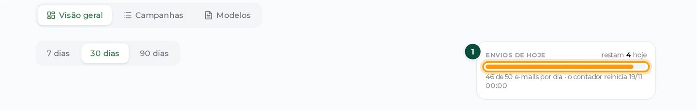
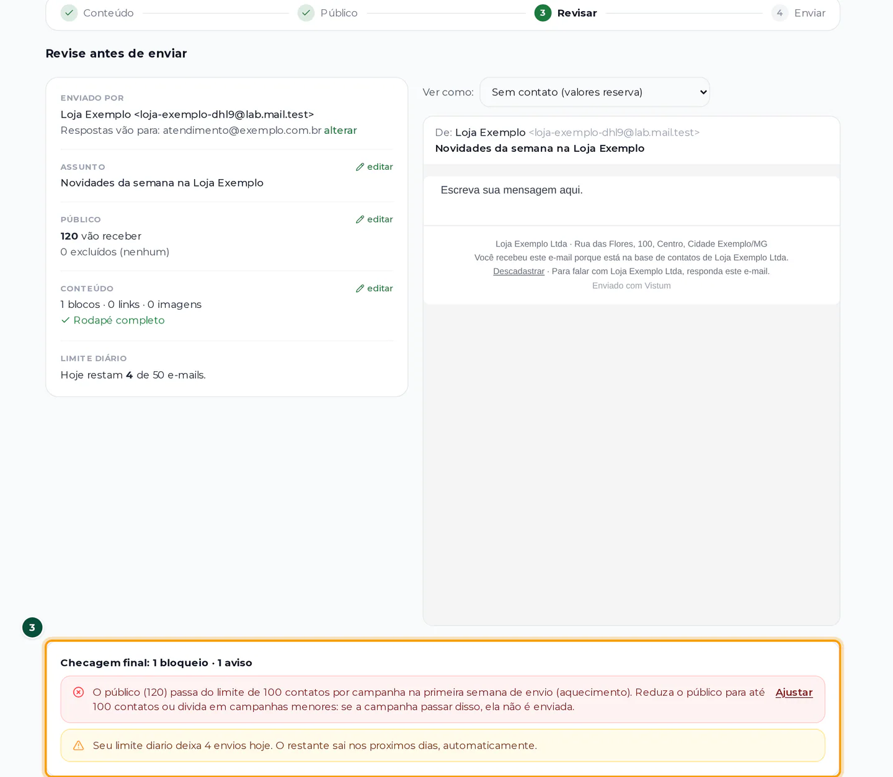

## Limites de envio

<Frame>
  
</Frame>

- **Conta em período de teste (trial)**: somente **5 e-mails no total** durante todo o teste, somando campanhas e e-mails de teste.
- **Conta paga, primeira semana de envio (aquecimento)**: até **50 e-mails por dia**.
- **Conta paga, depois da primeira semana**: até **500 e-mails por dia**, sujeito à saúde da reputação.
- **Cada contato recebe no máximo 3 e-mails a cada 7 dias**, somando todas as campanhas. Vale sempre.

Os números são o **teto**, não uma garantia de volume imediato: o que realmente sai depende também da reputação da conta. O cartão **Envios de hoje**, em **E-mail marketing → Visão geral**, mostra quanto resta hoje ("restam N hoje") e o limite do dia.

Quando a campanha é maior do que o limite de hoje, aparece **Campanha maior que o limite de hoje**. Não é erro: o restante sai nos dias seguintes, sozinho.

## Aquecimento: a primeira semana

<Frame>
  
</Frame>

O aquecimento serve para os provedores de e-mail (Gmail, Outlook e outros) conhecerem o seu remetente aos poucos. A semana tem **7 dias** e conta a partir do **primeiro envio real** de uma campanha; o e-mail de teste não conta.

Na primeira semana, cada campanha pode ter até **100 contatos**. Se o público passar disso, a **Revisão** bloqueia a campanha: divida a lista (por exemplo, por tag) em campanhas menores. Depois da primeira semana esse teto deixa de valer.

<Tip>
  Comece pelos contatos mais engajados (clientes recentes, quem já conversou com você) e deixe as listas antigas para depois da primeira semana.
</Tip>

## Proteção da reputação

Se a taxa de erros ou de reclamações ficar alta, o Vistum pode reduzir o limite ou pausar campanhas ("Pausado pelo sistema"). É uma proteção: as campanhas retomam quando a situação se normaliza.

## Consentimento e descadastro

- Todo e-mail de marketing leva no rodapé o link **Descadastrar** e os dados da sua empresa.
- Quem se descadastra, tem erro permanente (hard bounce) ou marca como spam **sai automaticamente** das próximas campanhas.
- A página pública de descadastro pede a confirmação (**Confirmar cancelamento**); só abrir o link não descadastra.
- Contatos sem consentimento registrado para e-mail de marketing ficam de fora por padrão, e aparecem na **Quebra do público**.
