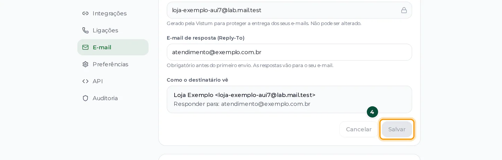
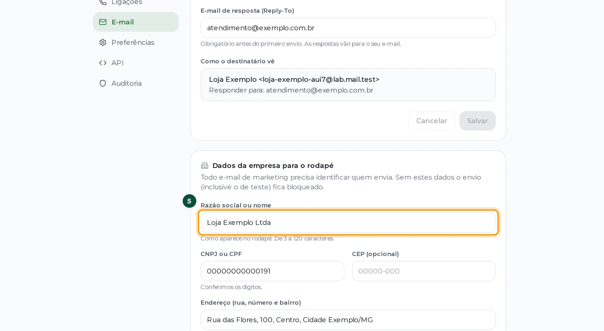
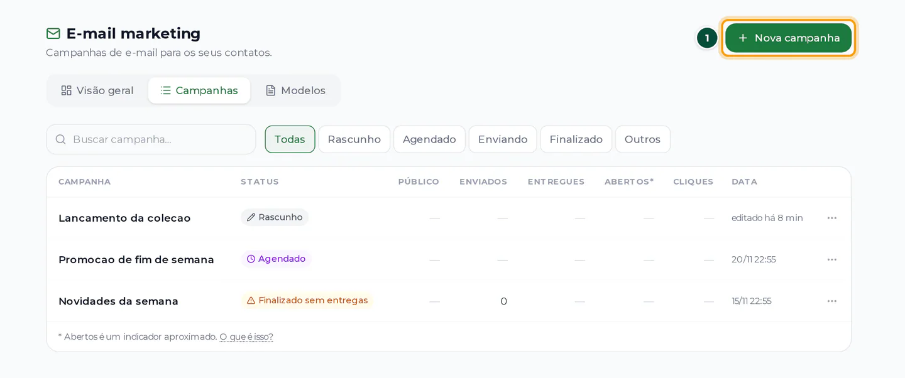
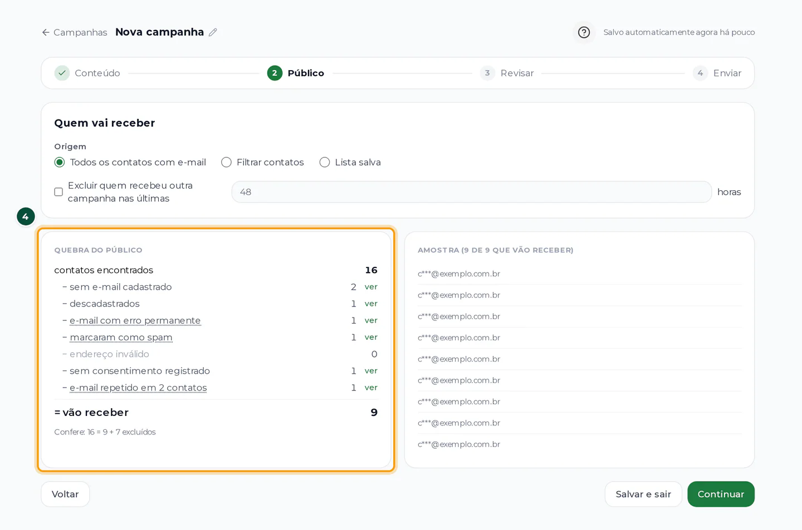
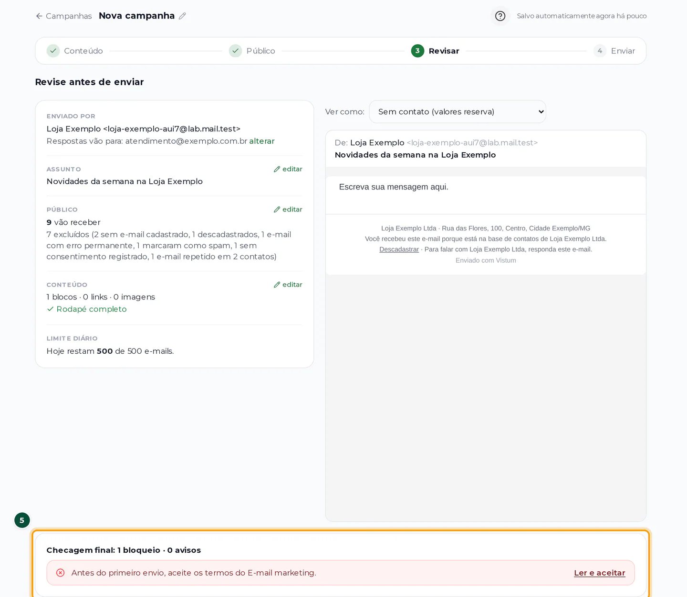

## Para que serve

O **E-mail marketing** do Vistum envia campanhas de e-mail para os contatos do seu CRM, com editor visual, modelos prontos, seleção por tags, etapas e campos, e relatório de resultados.

<Warning>
  É para **comunicação com quem já é seu contato** e aceita receber e-mails. Não serve para listas compradas, alugadas ou copiadas da internet.
</Warning>

Só o **proprietário** e os **administradores** do workspace veem e usam o E-mail marketing. Ele abre sozinho para contas com assinatura paga ativa e regular e e-mail do proprietário confirmado. Se a tela mostrar **Indisponível no momento**, siga o botão que ela traz.

## Antes do primeiro envio

Em **Configurações → E-mail** é preciso ter três coisas, inclusive para enviar um e-mail de teste:

<Steps>
  <Step title="Confirme o remetente">
    Confira o **Nome exibido**, informe o **E-mail de resposta (Reply-To)** e clique em **Salvar**. O endereço de envio é gerenciado pelo Vistum e não pode ser alterado.

    <Frame>
      
    </Frame>
  </Step>
  <Step title="Preencha os dados da empresa">
    Em **Dados da empresa para o rodapé**, informe razão social, CNPJ ou CPF e endereço, e clique em **Salvar dados da empresa**.

    <Frame>
      
    </Frame>
  </Step>
  <Step title="Aceite os termos">
    Na revisão da campanha, clique em **Ler e aceitar**, marque **Li e aceito os termos do E-mail marketing em nome da minha empresa** e confirme com **Aceitar e continuar**. O proprietário sempre pode aceitar; o administrador só com delegação do proprietário.
  </Step>
</Steps>

## Criar e enviar

<Steps>
  <Step title="Clique em Nova campanha">
    Em **E-mail marketing → Campanhas**, clique em **Nova campanha** e escolha um modelo para começar.

    <Frame>
      
    </Frame>
  </Step>
  <Step title="Preencha o assunto e o conteúdo">
    No editor, adicione blocos, personalize com variáveis (o botão **Variável** insere, por exemplo, `{Primeiro nome}`) e confira em **Prévia**. O editor funciona no computador; no celular só a prévia e o teste.
  </Step>
  <Step title="Escolha quem vai receber">
    Na etapa **Público**, escolha a origem (filtros por tag, etapa e campos, ou uma lista salva). A **Quebra do público** mostra quem fica de fora: descadastrados, sem consentimento registrado, endereço inválido e quem já recebeu o limite da semana.

    <Frame>
      
    </Frame>
  </Step>
  <Step title="Envie um teste">
    Clique em **Enviar teste**. O teste só vai para a equipe e leva o prefixo `[TESTE]`.
  </Step>
  <Step title="Revise e envie ou agende">
    Na **Revisão**, resolva os bloqueios da **Checagem final**. Na etapa **Enviar**, envie agora ou escolha **Agendar** com data, hora e fuso (pelo menos 10 minutos à frente).

    <Frame>
      
    </Frame>
  </Step>
</Steps>

<Check>
  Pronto! A campanha aparece em **Campanhas** com o status **Enviando** e depois **Finalizado**. Veja [Limites, aquecimento e descadastro](/email/limites-aquecimento-consentimento) e [Resultados](/email/resultados).
</Check>
