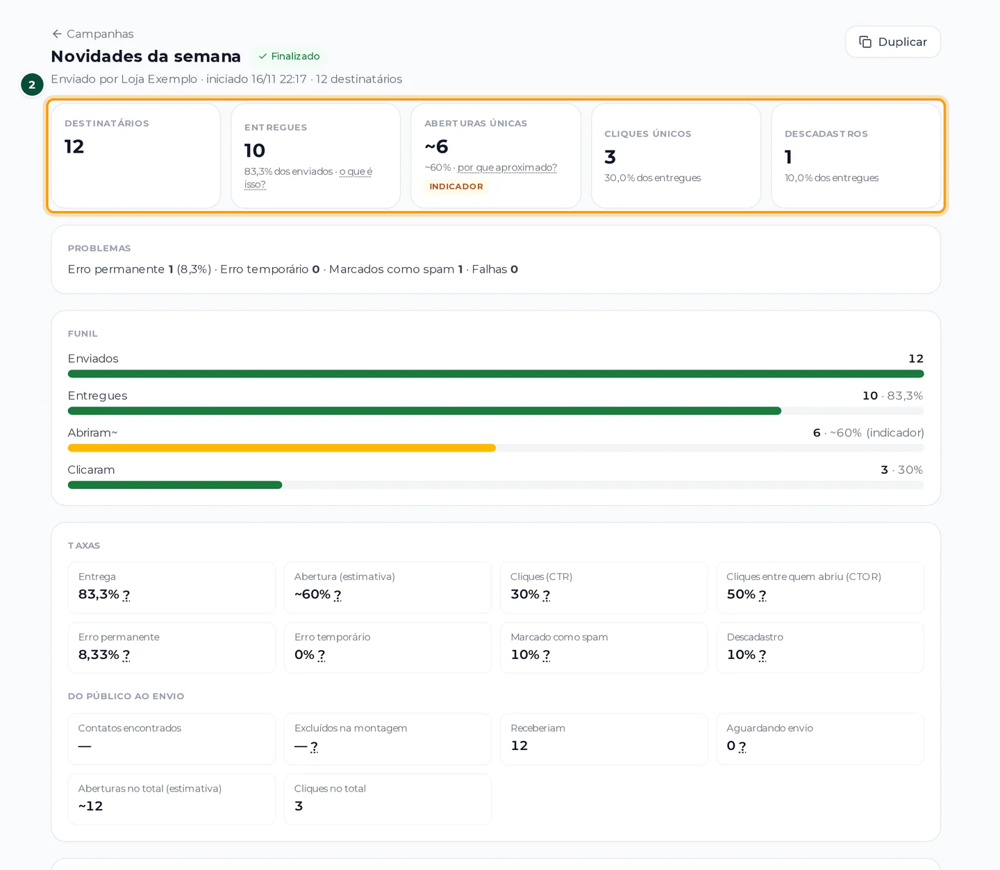

## Ler os resultados

<Frame>
  
</Frame>

Abra a campanha em **E-mail marketing → Campanhas**. A tela mostra os números principais (enviados, entregues, aberturas, cliques, descadastros e erros), a seção **Problemas**, o **Funil** e quem fez cada coisa. A **Visão geral** resume os últimos 7, 30 ou 90 dias.

<Warning>
  A **abertura é uma estimativa**: aplicativos de e-mail podem inflar ou esconder esse número. Compare com os **cliques** antes de concluir algo.
</Warning>

A aba **Pulados** mostra quem ficou de fora e por quê: descadastrou, sem consentimento, endereço inválido ou já recebeu o limite de 3 e-mails em 7 dias.

## Avisos comuns

- **Indisponível no momento**: a conta não cumpre os requisitos (assinatura, pagamento ou e-mail do proprietário). Siga o botão da tela.
- **Falta o e-mail de resposta / Confirme seu remetente**: abra **Configurações → E-mail**, informe o **E-mail de resposta** e salve.
- **Preencha os dados da empresa**: complete razão social, CNPJ ou CPF e endereço em **Configurações → E-mail**.
- **Nenhum contato vai receber esta campanha**: o público ficou vazio. Abra a **Quebra do público** e veja o motivo principal.
- **O limite de hoje acabou**: não é erro; o restante sai nos dias seguintes.
- **O público passa do limite de 100 contatos**: vale só na primeira semana; divida a lista.
- **Pausado pelo sistema**: leia a nota na campanha, resolva o motivo e retome; se não conseguir, fale com o suporte.
- **O horário do agendamento é recusado**: o horário precisa estar pelo menos 10 minutos à frente, no fuso escolhido.
