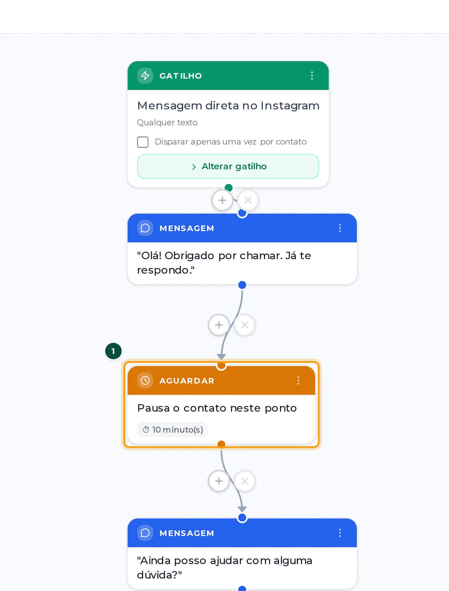
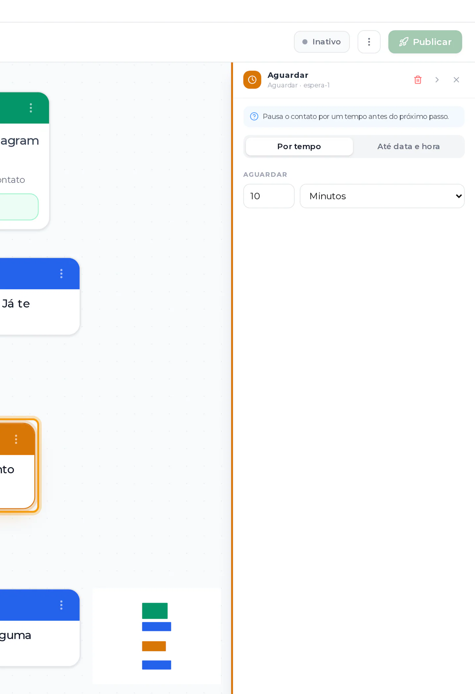
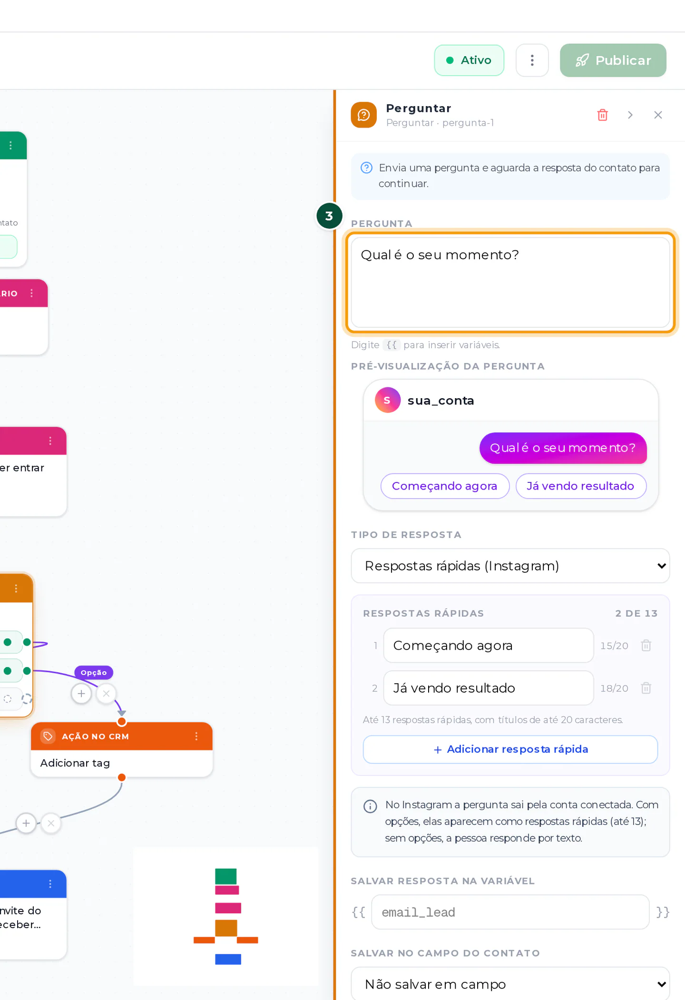

## Para que serve

Em uma automação do Instagram você controla o ritmo da conversa com dois blocos da paleta **Tempo e espera**:

- **Esperar um tempo**: o fluxo aguarda antes de seguir (no fluxo ele aparece como **Aguardar**);
- **Perguntar e aguardar resposta**: o fluxo faz uma pergunta e só continua quando a pessoa responde.

Eles ficam no mesmo editor visual das automações do WhatsApp.

<Warning>
  Toda mensagem de DM só sai **dentro de 24 horas da última mensagem da pessoa**. Se a espera passar disso, a mensagem seguinte não sai e o histórico mostra **Fora da janela de 24h**. Veja [Erros e soluções do Instagram](/instagram/erros).
</Warning>

## Como montar

<Steps>
  <Step title="Abra o fluxo no editor">
    Em **Automações → Instagram**, clique em **Editar** na automação. O exemplo é um fluxo de boas-vindas: a pessoa escreve, o Vistum responde, aguarda 10 minutos e manda uma segunda mensagem.
    <Frame>
      
    </Frame>
  </Step>
  <Step title="Ajuste o bloco Aguardar">
    Arraste **Esperar um tempo** para entre as duas mensagens e clique nele. Em **Por tempo**, informe o **valor** e a **unidade** (o bloco novo vem com 5 minutos). A aba **Até data e hora** espera até um momento marcado.
    <Frame>
      
    </Frame>
  </Step>
  <Step title="Pergunte e espere a resposta">
    Quando a próxima mensagem depende do que a pessoa responde, use **Perguntar e aguardar resposta**. Escreva a pergunta e escolha em **Tipo de resposta** como ela responde: digitando ou tocando em uma opção (**Respostas rápidas**). Em **Salvar resposta na variável** você guarda o que a pessoa respondeu. Cada opção abre um caminho próprio no fluxo (de 1 a 13 opções, até 20 caracteres cada).
    <Frame>
      
    </Frame>
  </Step>
  <Step title="Publique e teste com uma segunda conta">
    Clique em **Publicar** e teste com outra conta do Instagram. A simulação **Testar** do editor não valida a janela de 24 horas.
  </Step>
</Steps>

## Se algo der errado

- **A segunda mensagem não saiu**: confira se passou de 24 horas desde a última mensagem da pessoa.
- **O Publicar recusou o bloco de pergunta**: pergunta vazia, opção acima de 20 caracteres ou mais de 13 opções.
- Os botões do Instagram não aparecem no Instagram web (computador): a pessoa pode digitar o título da opção. Veja [Palavras-chave e botões](/instagram/palavras-chave-botoes).

<Check>
  Pronto! Seu fluxo agora tem ritmo. Veja também [Automações de mensagem direta](/instagram/automacoes-dm).
</Check>
