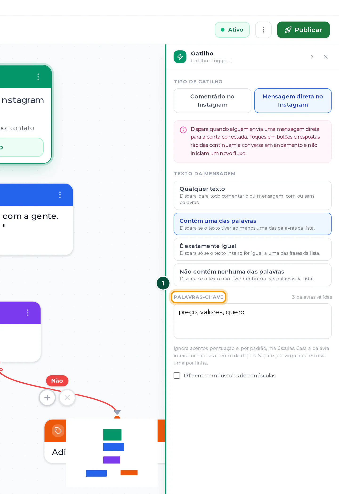
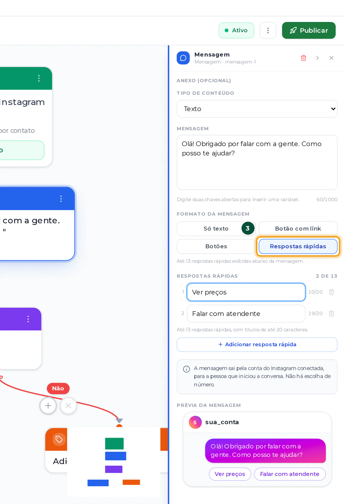
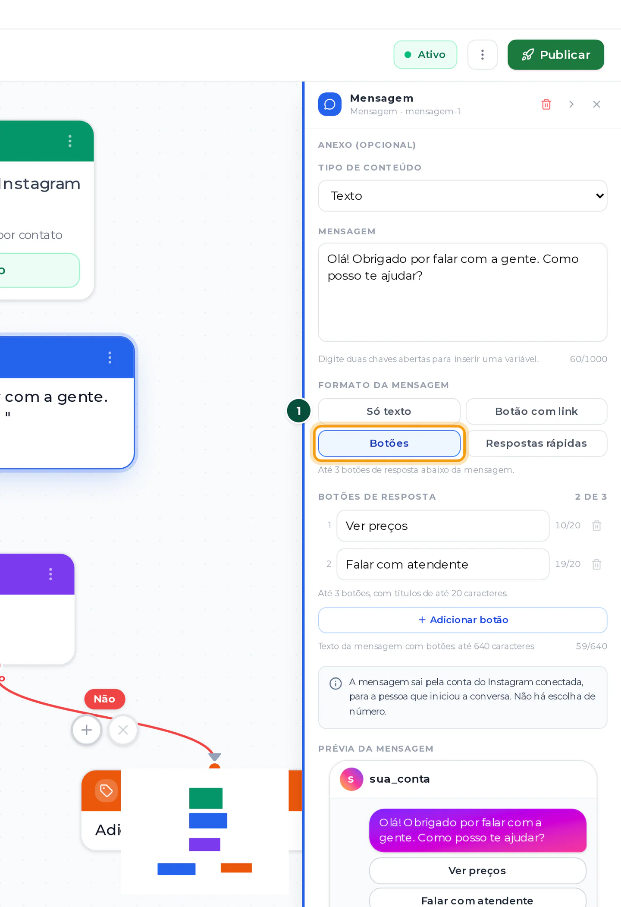

## Palavras-chave

A palavra-chave decide **quando** uma automação do Instagram começa. Ela vale para mensagens diretas e para comentários.

<Steps>
  <Step title="Abra o gatilho da automação">
    Na aba **Instagram** de **Automações**, abra a automação e clique no gatilho (**Mensagem direta no Instagram** ou **Comentário no Instagram**).
  </Step>
  <Step title="Escolha o modo">
    - **Qualquer texto**: dispara para toda mensagem ou comentário. Use com cuidado.
    - **Contém uma das palavras**: dispara se o texto tiver ao menos uma palavra da lista.
    - **É exatamente igual**: dispara só se o texto inteiro for igual a uma das frases. É o mais seguro para chamadas como "Comente QUERO".
    - **Não contém nenhuma das palavras**: dispara se o texto não tiver nenhuma das palavras.

    <Frame>
      
    </Frame>
  </Step>
  <Step title="Digite as palavras">
    Separe por vírgula ou escreva uma por linha (por exemplo `preço, valores, quero`). Se o campo ficar vazio em um modo que exige palavra, o **Publicar** recusa e avisa.
  </Step>
</Steps>

Como a comparação funciona:

- Maiúsculas e minúsculas não importam, por padrão.
- No modo **Contém**, acentos e pontuação são ignorados e a palavra casa inteira ("oi" não dispara dentro de "depois").
- No modo **É exatamente igual**, a frase inteira precisa bater, e acentos contam.
- Quando a pessoa escreve **PARAR**, **SAIR** ou **CANCELAR**, o Vistum registra o pedido e não envia mais automações para ela.

## Botões e respostas rápidas

<Frame>
  
</Frame>

<Frame>
  
</Frame>

O formato é escolhido no bloco de mensagem:

- **Só texto**.
- **Botões**: até **3** botões de resposta. O texto aceita até **640 caracteres** quando há botões, e cada título até **20 caracteres**.
- **Botão com link**: um botão que abre um endereço. Precisa começar com `https://` e não pode ter espaços.
- **Respostas rápidas**: até **13** opções.

A lista de opções do WhatsApp não existe no Instagram.

<Warning>
  Hoje o **Instagram na versão web (computador)** não mostra os botões clicáveis para quem recebe a mensagem. Eles aparecem no aplicativo do celular. Quem está no computador pode digitar o título do botão que o fluxo continua.
</Warning>

Um botão do tipo **Link** só abre o endereço: o Vistum não sabe quem clicou. Para registrar quem se interessou, use um botão do tipo **Resposta**.
